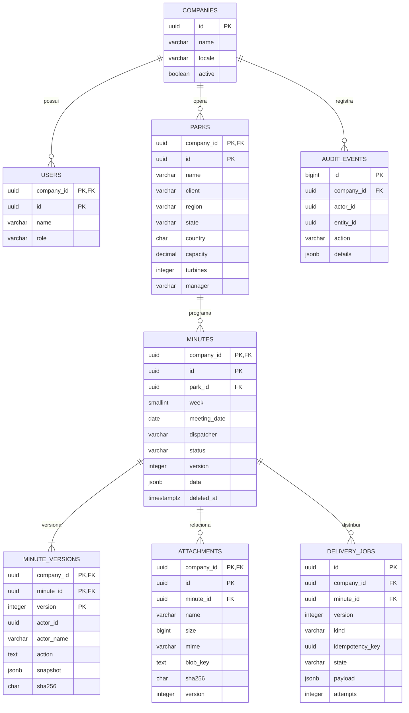

# Arquitetura

## Decisões

Next.js 16/React 19, TypeScript, Tailwind 4, Radix UI e Button no padrão shadcn/CVA.
Tiptap, React Hook Form/Zod, Recharts, Lucide e Framer Motion para os fluxos da UI.
NestJS 11/Node.js 24 com domínio, aplicação, infraestrutura e apresentação.
CQRS separa comandos/consultas; repositório abstrato isola PostgreSQL.

PostgreSQL 17 foi escolhido dentre as opções. Em Azure, usar PostgreSQL Flexible Server;
Azure SQL exigiria outro driver e dialeto. JSONB suporta seções e blocos personalizados,
e colunas relacionais cobrem filtros de rotina. SQL parametrizado é suficiente;
a função SQL de proteção da auditoria usa triggers, sem stored procedures de negócio desnecessárias.

## Solução

```mermaid
flowchart LR
  user[Dispatcher / Admin / Leitor] --> ui[Next.js: protótipo local]
  ui --> local[(Armazenamento do navegador)]
  user -. integração UI pendente .-> entra[Entra ID + MFA via Conditional Access]
  entra -. access token .-> api[App Service: NestJS]
  api --> cqrs[Comandos / Consultas]
  cqrs --> repo[Repository]
  repo --> db[(Azure PostgreSQL)]
  api --> blob[Azure Blob privado]
  api --> vault[Key Vault]
  api --> ai[Azure OpenAI]
  db --> outbox[Outbox transacional]
  outbox --> worker[Worker: PDF e envio]
  worker --> blob
  worker --> graph[Microsoft Graph]
  graph --> outlook[Outlook]
  graph --> teams[Teams: consentimento específico]
  ui -. links .-> docs[SharePoint / OneDrive / Power BI]
```

Linhas pontilhadas indicam conexão pendente ou baseada apenas em links.
A UI ainda não consome a API; ambos são executáveis independentes.

## Modelo ER



Conteúdo JSONB: parque, semana, data, território, dispatcher, participantes, checklist,
`sections[{title,content}]` e `links[{title,url}]`. Participantes são texto livre com papéis,
não entidades normalizadas nesta versão. Todas as relações de negócio incluem `company_id`.

## Versionamento e Envio

1. Criar/editar grava ata e snapshot na mesma transação.
2. Edição exige `If-Match`; versão antiga retorna 409, sem sobrescrita silenciosa.
3. Alterações de anexos incrementam versão e registram ação.
4. Envio congela conteúdo e anexos no payload da outbox e registra snapshot.
5. Worker gera PDF, armazena no Blob e chama Graph.
6. Aceite Graph registra `SENT`; status da ata só muda se a versão continua igual à agendada.
7. Uma edição nova não é sobrescrita pelo retorno de um envio antigo.
8. Exclusões de atas são lógicas; triggers bloqueiam UPDATE/DELETE dos registros de auditoria.

Hashes não são assinatura digital nem proteção contra DBA privilegiado.
Snapshots incluem a ata; versões de anexos ficam na tabela e no payload congelado do envio.
Não existe restauração visual de snapshots nesta versão.

## Segurança e Escala

JWT RS256 com JWKS, issuer específico, audience, expiração, tenant e app role.
Empresa vem do token, nunca do body. Tenant precisa estar ativo em `companies`.
Schema multiempresa, mas autenticação atual single-tenant por implantação;
federação global exige allowlist de issuers e roteamento de identidade.
MFA deve ser imposto pelo Entra. RBAC na API, não apenas na UI.

SQL parametrizado, Zod estrito, rate limit, Helmet, CORS restrito e limites de upload.
Blob privado, download autenticado, validação de assinatura de arquivo e SHA-256.
Antimalware/quarentena e sanitização do HTML na futura integração da UI são gates de produção.

Índices: empresa/data, parque/semana, status, dispatcher, região, anexos e fila.
Pool: 20 conexões por instância; revisar ao escalar horizontalmente.
Paginação API: até 100 registros. Worker usa `FOR UPDATE SKIP LOCKED`.
Job expirado ou falha incerta vira `UNCERTAIN`, sem retry cego: Graph pode ter aceitado a mensagem.
Entrega exatamente uma vez não é prometida. Reconciliar via Sent Items e header do job.
500 usuários/100 mil atas exigem teste de carga com SLOs, não foram demonstrados.