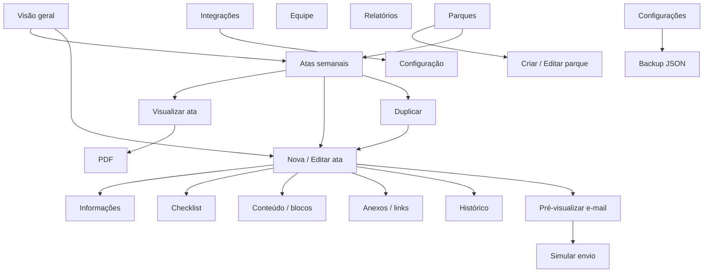

# Wireframes

Protótipo executável Next.js. Desktop: sidebar 233 px, topbar 76 px, conteúdo fluido,
KPIs em quatro colunas e superfícies com raio até 8 px. Mobile: drawer, uma/duas colunas,
tabelas com scroll próprio e modal quase fullscreen. Paleta Vestas, Manrope/DM Sans e Lucide.

## Mapa de Fluxos



## Visão Geral

```text
+----------------+-------------------------------------------------------+
| windplanner    | Workspace > Visão geral     Buscar    Tema Sino Perfil |
| Vestas Brasil  +-------------------------------------------------------+
| Visão geral    | Cada semana, uma direção.                 + Nova ata   |
| Atas semanais  | Região v    Parque v                       Período v   |
| Parques        | [Total]      [Enviadas]     [Pendentes]    [Rascunhos]  |
| Equipe         | Evolução semanal                  Atas por parque      |
| Relatórios     | Atas recentes                          Ver todas       |
| Integrações    | Parque | Semana | Dispatcher | Data | Status | Ações   |
| Configurações  | Fotografia eólica + contexto       Últimos envios      |
| Ajuda          | Rodapé / Slogan / Ajuda                               |
+----------------+-------------------------------------------------------+
```

## Telas e Estados

| Tela | Estrutura / ações |
|---|---|
| Atas semanais | Título, Nova ata, busca, status, parque, Filtros avançados, tabela, paginação |
| Filtros avançados | Dispatcher, região, semana, data inicial/final; vazio com limpar filtros |
| Nova/Editar | Modal com cinco abas; cancelar, salvar rascunho, revisar/enviar |
| Informações | Parque/território, semana/data, dispatcher, participantes; erros nos campos |
| Checklist | Barra de progresso, revisão rápida, 13 checkboxes em duas/uma colunas |
| Conteúdo | Índice de seções, editor rico, bloco personalizado, análise local de resumo/riscos |
| Anexos/links | Seletor, versões, preview/download/lixeira, título/URL e lista clicável |
| Histórico | Versão, ação, autor, data; vazio antes da primeira gravação |
| Detalhe | Mesmo modal em leitura, exportar PDF |
| E-mail | Destinatários, assunto, corpo, links, anexos; cancelar/simular; validação junto ao campo |
| Preview | Modal com imagem/PDF; fallback Office e download |
| Parques | Resumo, busca, grid com foto, estado, cliente, capacidade, turbinas e gestor |
| Criar/Editar parque | Nome, cliente, região, estado, MW, turbinas, gestor; salvar/cancelar |
| Equipe | Avatar, nome, e-mail, perfil, atas, acesso demonstrativo |
| Relatórios | Filtros, KPIs, linha semanal, barras dispatcher, pizza região e parques |
| Integrações | Aviso, seis serviços, Não configurado, modal de requisitos sem coletar segredos |
| Configurações | Preferências, switch tema, perfil demo; segurança, dados e backup JSON |
| Ajuda | Modal com fluxo de uso e aviso de demonstração |
| Exclusão | Confirmação explícita; parque com histórico é bloqueado |
| Notificações | Popover com pendências e acesso ao histórico |

Mobile: índice do editor horizontal rolável, formulário reorganizado e botões sem sobreposição.
Tema escuro preserva semântica de status e foco. Movimento reduzido respeitado.

## Login Corporativo Planejado

Não implementado no frontend. Alvo: marca Wind Planner, Entrar com Microsoft,
redirecionamento PKCE, erro de consentimento, sair e retorno à rota solicitada.
MFA ocorre na Microsoft, nunca formulário local de senha/código.
Após login, carregar `/me`, parques, dashboard e atas da API e substituir dados locais.